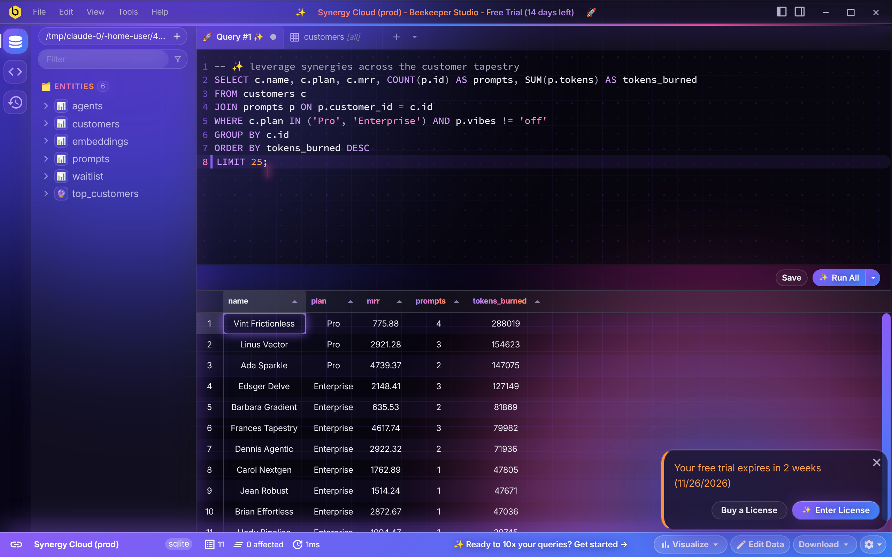
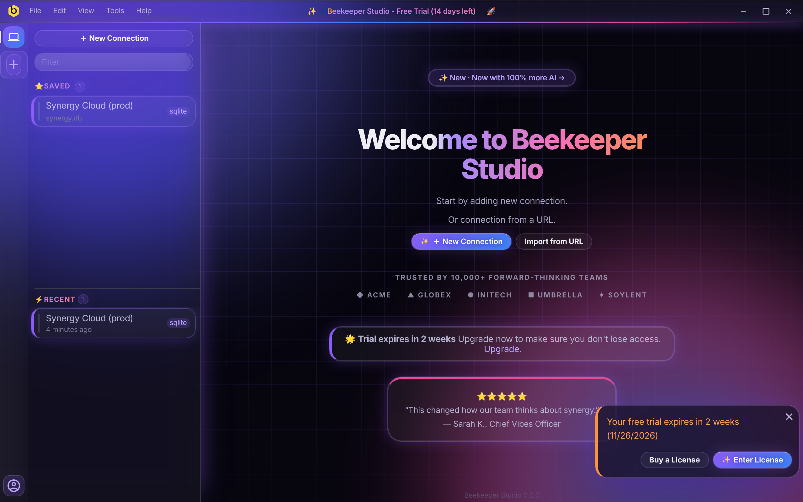
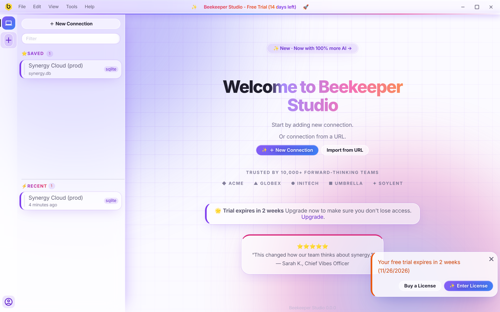
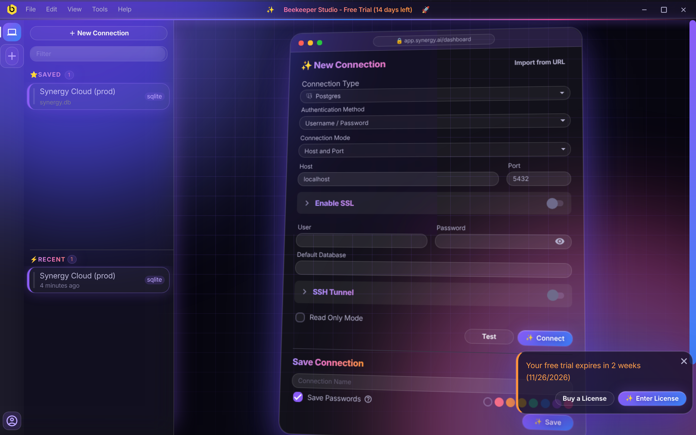
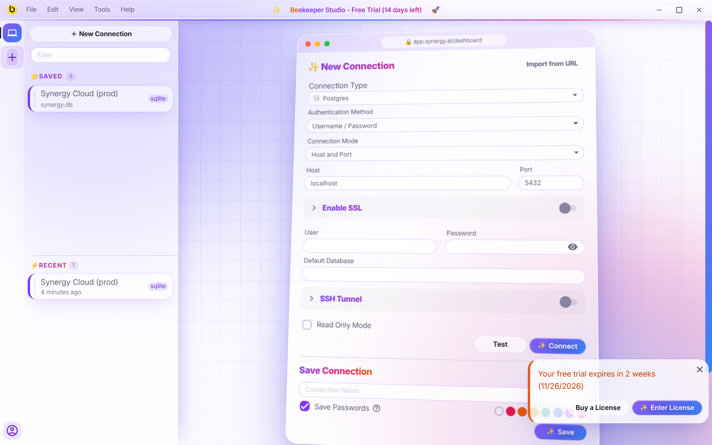
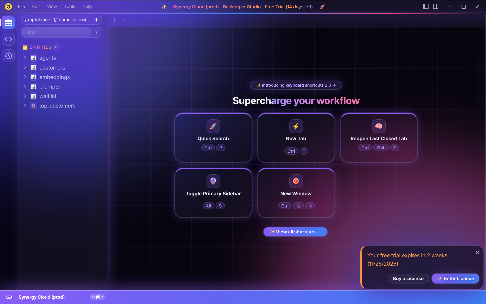
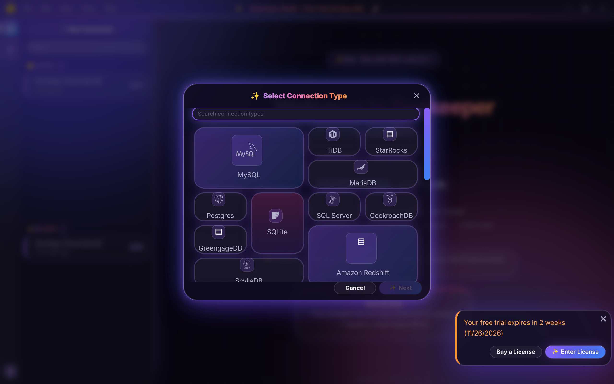
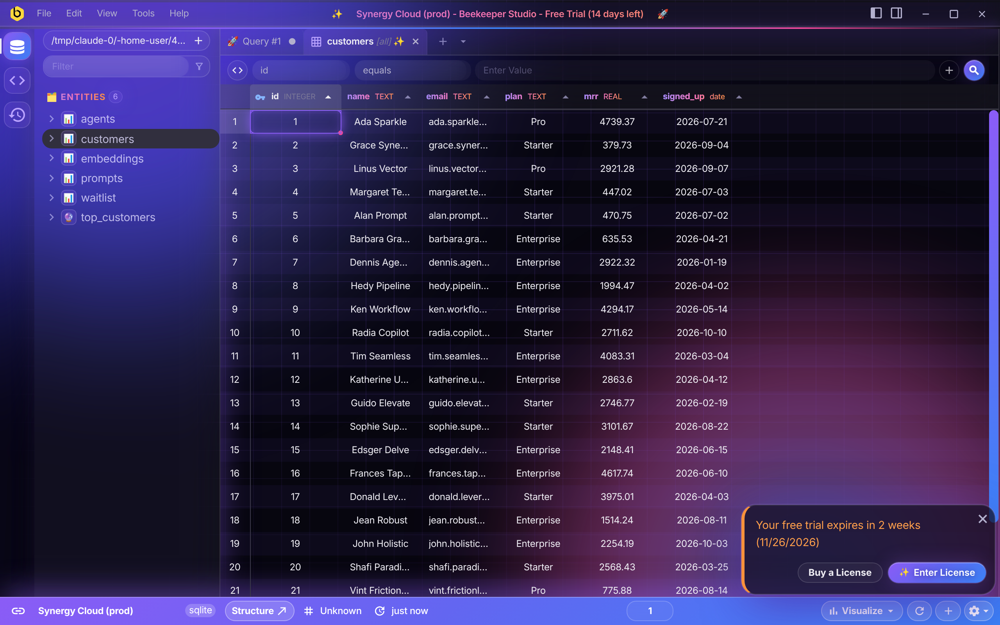
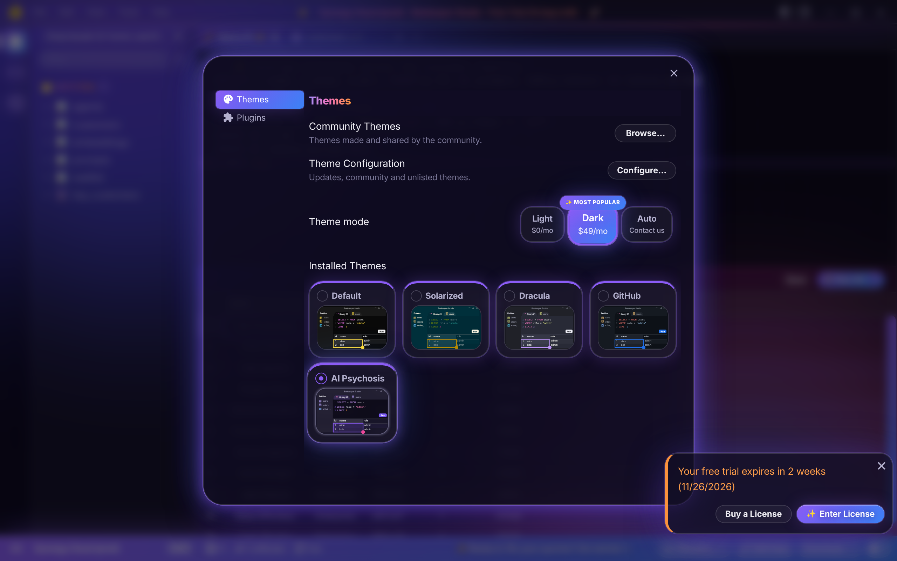
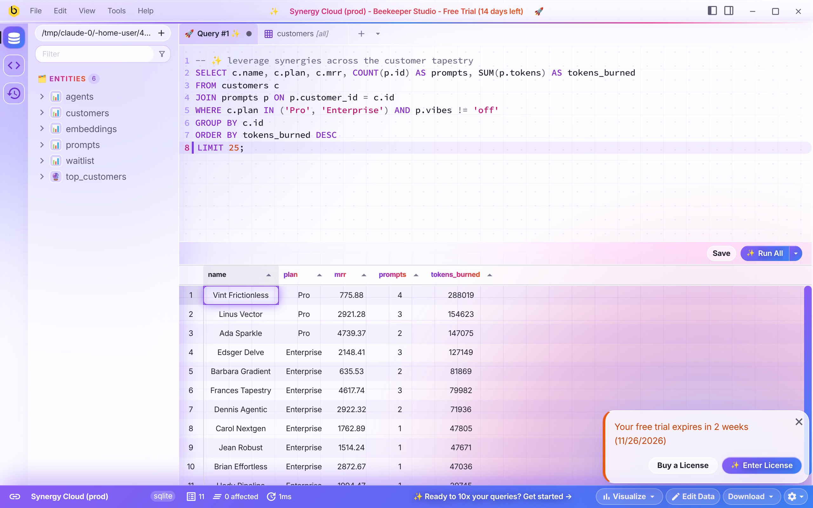

# ✨ AI Psychosis 🚀

A [Beekeeper Studio](https://www.beekeeperstudio.io) theme that commits every AI design trope at once.
Purple gradients, glass, glow, sparkles, Inter. For AI maximalists.



Comes in dark (neon "premium dev tool") and light (pastel SaaS landing page).

## Screenshots

| | |
| --- | --- |
|  Welcome screen |  Welcome screen, light |
|  Connection form |  Connection form, light |
|  Empty workspace |  Connection type picker |
|  Table view |  Appearance window |
|  Query editor, light | |

## Trope checklist

| # | Trope | Where to find it |
| --- | --- | --- |
| 1 | Purple-to-blue gradients | Primary buttons, status bar, active rail icon, selected headers, scrollbars |
| 2 | Emoji as icons | 📊 tables, 🔮 views, 🚀 query tabs, 🗂️ ⭐ ⚡ section labels |
| 3 | The sparkle icon | ✨ on every primary button, the active tab, the title bar and modal titles |
| 4 | Gradient text on headline keywords | Welcome headline, title bar, column headers, section labels, every heading |
| 5 | Three-column feature card grid | Keyboard shortcut hints: icon on top, heading, grey text |
| 6 | Glowing blurred blobs | Two of them, drifting behind everything |
| 7 | Glassmorphism everywhere | Sidebars, tabs, title bar, modals, menus, cards |
| 8 | The identical page skeleton | Welcome screen: hero, logo strip, quote card. The status bar is the CTA band |
| 9 | Fade-in-up on everything | Rows, list items, tabs, modals, editor lines. Buttons and cards scale on hover |
| 10 | Dot or grid pattern backgrounds | Grid behind the app fading through a radial mask, dots behind the editor |
| 11 | The pill badge above the headline | "✨ New · Now with 100% more AI →" |
| 12 | Dark mode with neon glow | Dark mode |
| 13 | Bento grids | Connection type picker |
| 14 | The floating hero mockup | The connection form: fake browser frame, tilted, glowing. Straightens when hovered or focused |
| 15 | Centre-aligned everything | Table cells, column headers, modal titles, welcome screen |
| 16 | Cards with a coloured left or top border | Saved connections, notifications, alerts, feature cards, theme tiles |
| 17 | Over-rounded corners and soft shadows | Everything |
| 18 | Icons in tinted rounded squares | Sidebar rail, entity icons, feature cards, connection types |
| 19 | The three-tier pricing layout | Theme mode: Light, Dark (✨ MOST POPULAR, $49/mo), Auto (Contact us) |
| 20 | Default typography | Inter, bundled |

The companies in the logo strip, the testimonial and the pricing are all invented.

## Install

Once published, find **AI Psychosis** under **View → Appearance → Community Themes**.

To install from source:

1. Enable unlisted themes in your Beekeeper Studio [config](https://docs.beekeeperstudio.io/user_guide/configuration/):

   ```ini
   [themeSystem]
   unlistedDisabled = false
   ```

2. Link this folder into the themes directory. The link name must be `ai-psychosis`.

   ```bash
   mkdir -p ~/.config/beekeeper-studio/themes
   ln -s "$(pwd)" ~/.config/beekeeper-studio/themes/ai-psychosis
   ```

   On macOS the themes directory is `~/Library/Application Support/beekeeper-studio/themes`,
   on Windows `%APPDATA%\beekeeper-studio\themes`.

3. Restart Beekeeper Studio and pick **AI Psychosis** in **View → Appearance**.

## Files

- `manifest.json` - theme metadata
- `style.css` - the theme. Each section is commented with the trope it commits
- `fonts/` - Inter (latin, variable weight), [SIL Open Font License](fonts/OFL.txt)

Animations are switched off when the system asks for reduced motion.

## License

MIT. Inter is licensed separately under the OFL.
